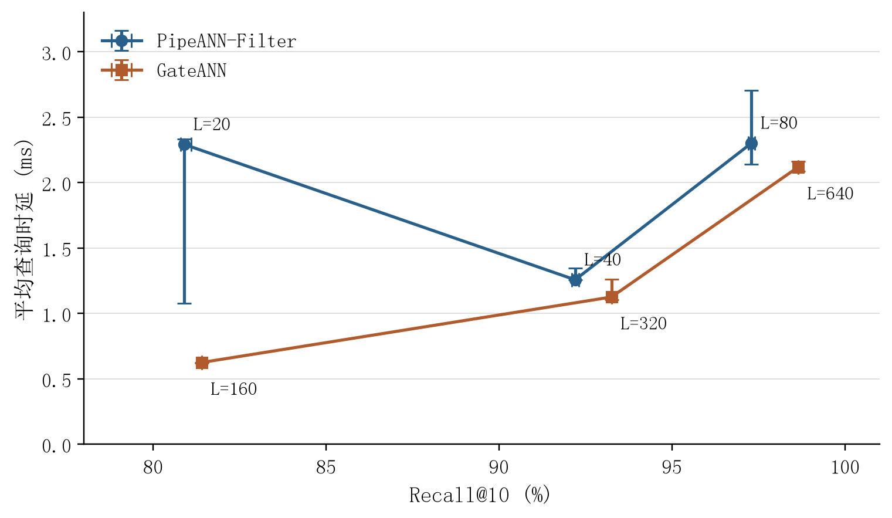
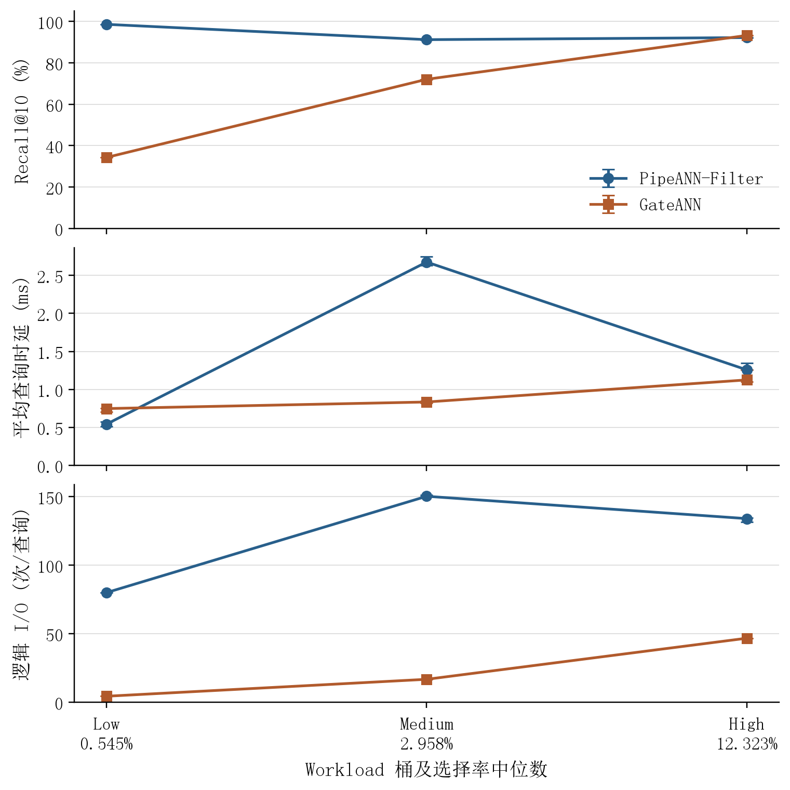
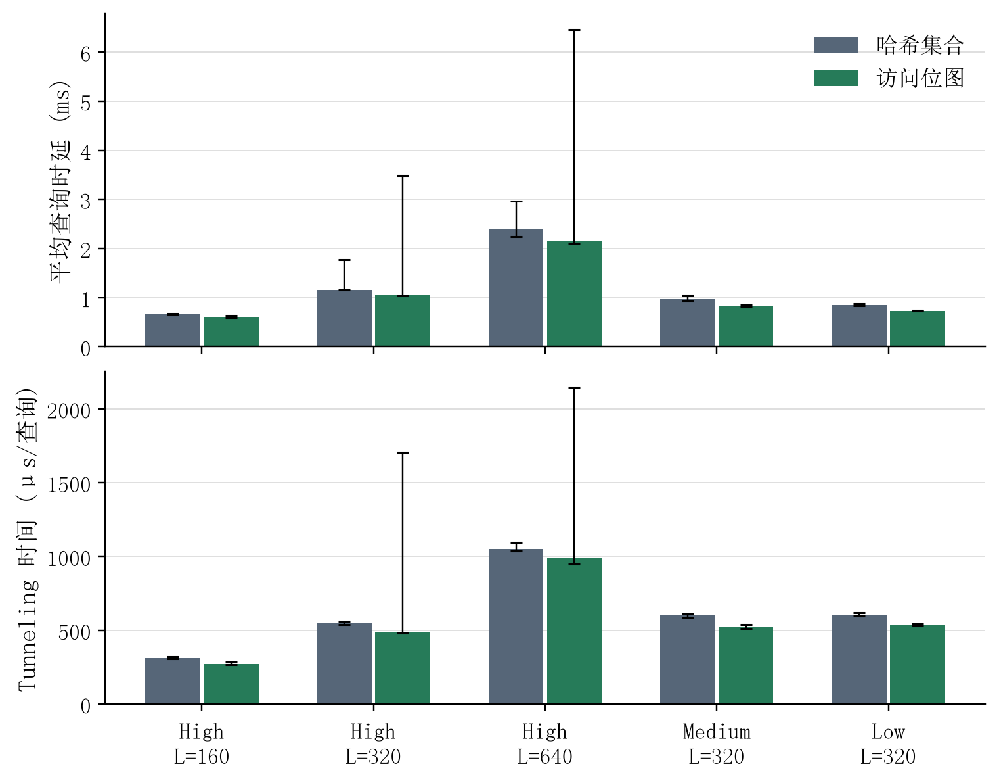

# SSD 过滤向量检索系统性能比较与 GateANN 访问位图优化

本仓库保存计算机系统设计课程实验的优化实现、真实测量结果、统计绘图程序和复现说明。基础实验比较课程固定版本 PipeANN-Filter 与 GateANN；补充实验在 GateANN 中实现查询内的稠密访问位图，减少遍历节点时的哈希查找开销。

## 测量结论

- 基础实验：课程默认的 10 个配置，每个重复 3 次，共 30 行结果。
- 优化实验：同一个构建在 `hash` / `bitmap` 两种模式之间切换，5 个配置各重复 7 次，共 70 行结果。固定 CPU 127，桶顺序按固定种子打乱，模式按轮次交替 AB/BA。
- 五组配置的查询时延中位数下降 9.45%–14.18%，Recall 中位数相同。Low、Medium 的 7 组配对均更快；High L=320/640 各有 1 轮更慢，范围图保留了所有异常值，因此不声称最坏延迟改善。
- Formal Low、L=320 的时延从 851.79 μs 降至 730.99 μs，Recall 均为 34.30%。优化不解决强过滤下返回不足的问题。







误差线均为实际最小值至最大值，不是置信区间。基础实验每组 n=3；优化实验每组 n=7。数据来自单台共享服务器及固定 YFCC 课程负载，不外推到所有数据集或 SSD。

## 文件入口

| 文件 | 内容 |
|---|---|
| `optimization/dense_visited.h` | 可独立审阅的 C++ 位图实现 |
| `patches/gateann_dense_visited.patch` | 完整上游源码改动，包含访问集合切换和正确性导出 |
| `patches/gateann_aio_compat.patch` | 课程提供的 AIO 编译兼容补丁 |
| `tests/test_dense_visited.cpp` | 1200030 次随机差分、边界、查询隔离及非法 ID 测试 |
| `scripts/prepare_optimization.sh` | 从课程固定提交准备并编译优化版本 |
| `scripts/run_optimization_experiment.py` | 正确性检查及 7 轮交替对照实验 |
| `scripts/validate_query_outputs.py` | 独立检查实际返回数量、标签、去重、精确 L2 排序及 Recall |
| `scripts/analyze_results.py` | 数据审计、三轮/七轮汇总及绘图 |
| `scripts/audit_deliverables.py` | 独立检查配置覆盖、原始退出状态和测量补丁哈希 |
| `data/baseline/` | 原始正式实验 30 行 CSV 及环境信息 |
| `data/optimization/` | 70 行对照结果、正确性检查及运行元数据 |
| `data/raw_logs.zip` | 基础实验与优化实验的原始日志、命令和正确性输出 |
| `figures/` | PNG/PDF/SVG 图与精确统计表 |

## 环境与固定版本

Ubuntu 22.04.4 x86-64，AMD EPYC 7542，128 个宿主机可见逻辑 CPU，251 GiB 宿主机可见内存；工作目录位于 Samsung 990 EVO Plus NVMe SSD 的 ext4 文件系统。资源由其他进程共享，不是独占配额。不使用 GPU。

- 课程仓库：<https://gitee.com/wei-fangyu/fvs-course-lab>，commit `e44eab5d1b040ffdebc80374a13b304a9c4d37de`。
- PipeANN-Filter：`2ec84fe20c37dc3cc236b66f7eba31c0cc80bf1e`。
- GateANN：`71e87cbf0e25c0400c0109dd25a64a7c4dccc9dd`。
- AIO、threads=1、beamwidth=8、K=10、mem_L=0、cache_budget=0、FullAdj R=32。
- High：PipeANN L=20/40/80，GateANN L=160/320/640；Medium/Low：PipeANN L=40，GateANN L=320。

## 复现

先按照课程 README 下载并校验数据、编译固定版本、完成 Debug 验证、下载正式索引。数据集、预构建索引、构建二进制和第三方完整源码不放入本仓库。

```bash
git clone https://github.com/Lydddddddd/fvs-ssd-filter-lab.git
cd fvs-ssd-filter-lab

# 将路径替换为自己的课程仓库绝对路径。
bash scripts/prepare_optimization.sh /path/to/fvs-course-lab

# output 必须为一个尚不存在的目录；CPU 必须在自己的亲和性允许范围内。
python3 scripts/run_optimization_experiment.py \
  --course-root /path/to/fvs-course-lab \
  --optimized-repo /path/to/fvs-course-lab/systems/GateANN-dense-opt \
  --output /path/to/new-experiment-directory \
  --repeats 7 --cpu 0

python3 -m pip install -r requirements.txt
python3 scripts/audit_deliverables.py
python3 scripts/analyze_results.py \
  --baseline data/baseline/results.csv \
  --optimization data/optimization/results.csv \
  --output figures --font /path/to/SimSun.ttf
```

中文图使用本机合法提供的宋体；字体文件不随仓库分发。不传 `--font` 时需要自行配置可用的中文字体，或将绘图标签改为英文。

报告生成程序为 `scripts/build_report.py`，以课程固定版本的 `docs/实验报告格式参考.docx` 为排版参考，正文设置宋体10.5 pt、1.25倍行距。重建时传入 `--template`、`--project`、`--output` 和 `--identity`；身份文件是包含 `name`、`student_id`、`class`、`department` 的私有JSON，不随公开仓库上传。PDF导出前须安装可用的宋体，并检查最终PDF确实嵌入SimSun，不能只检查DOCX字体设置。

运行二进制时，`GATEANN_VISITED_MODE=bitmap` 启用位图；未设置或设为 `hash` 使用哈希路径。位图仅在 GateANN 的 filter-precheck 模式生效。`GATEANN_RESULT_DUMP=/path/prefix` 会在查询计时结束后导出实际结果与返回数量；性能实验不设置此变量。

## 正确性与统计口径

节点 ID 在 `[0,N)` 内时，位图是精确集合，存储量为 `ceil(N/64)*8` 字节。N=1000000 时为 125000 字节，初始化和释放包含在外层 Query Phase 墙钟计时中；不同查询拥有独立存储。没有新增跨查询结果缓存，也没有改变过滤谓词、L、图或索引文件。

Debug/Formal 共 10 组配置的全部实际返回结果均独立通过标签、ID 唯一性及精确 L2 排序检查。9 组的有序 top-10 文件逐字节相同；另一组仅有 0.05 个百分点 Recall 差异。对完全相同的 hash 程序再重复 10 次，可观察到 85.75%/85.80% 两种结果，说明固定近似搜索存在输出波动；相关记录见 `async_control.json`。这不构成所有运行输出完全相同的承诺。

低选择率时，原驱动将不足 K 的位置填 0。检查器使用 `pipe_search` 的实际返回数量，只验证真正返回的 ID，并明确统计填充位置；不把占位 0 当成有效答案。Formal Low 的 200 次查询仅实际返回 757 个 ID，25 次凑齐 10 个，22 次无结果，解释了低 Recall 的一个直接原因。

`mean_ios` 是系统内部逻辑 I/O，不等于物理块设备 I/O；跨系统页面布局和计数实现不同。`peak_rss_kb` 单位为 KiB，覆盖整个查询子进程，不能单独归因于位图或 FullAdj。GateANN 平均时延由整数 QPS 的倒数得到，存在输出量化误差。未清空 OS page cache，也没有把时间分解的若干部分强行相加为总时间。

## 来源与许可

基础流程和 AIO 兼容补丁来自课程仓库；优化基于 GateANN 的 MIT 许可源码，相关版权声明保存在 `THIRD_PARTY_GATEANN_LICENSE`。上游程序、课程工作负载与本仓库的优化改动在报告中分别说明，不将上游算法声称为自行提出。报告 PDF 按课程要求另行提交，公开仓库以代码、结果与复现材料为主。
